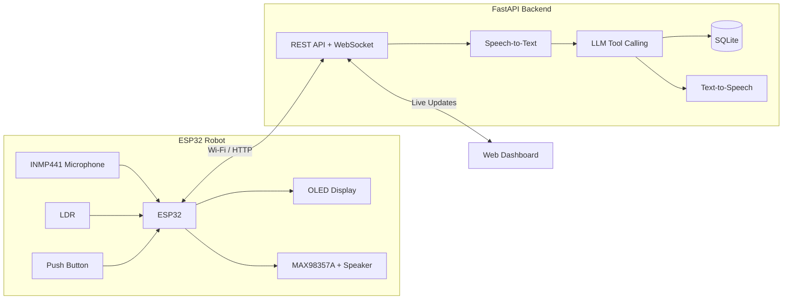
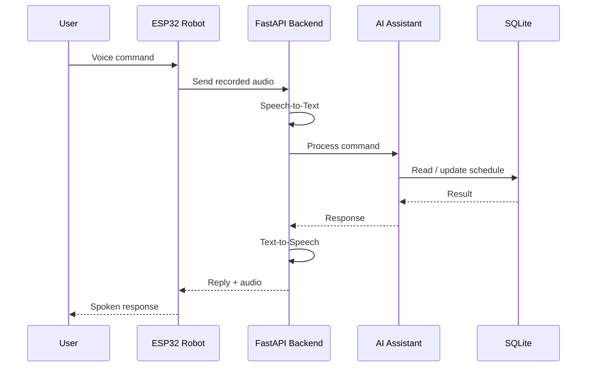

# AI Personal Planner Robot


An ESP32-based AI personal planner robot that manages schedules, alarms, and reminders through natural voice interaction.

The robot combines embedded systems, IoT communication, speech recognition, AI-based natural language processing, and a FastAPI backend to provide an interactive personal scheduling assistant.

---

## Features

- **Natural voice commands** — create, move, cancel, and query scheduled events.
- **AI-powered command processing** — understands natural-language scheduling requests.
- **Conversation mode** — continues listening after a response for follow-up commands.
- **Smart alarm system** — alarms are synchronized from the backend and triggered by the ESP32.
- **Morning routine** — after an alarm is stopped, the robot can greet the user and read today's plans.
- **Speech-to-Text (STT)** — converts spoken commands into text.
- **Text-to-Speech (TTS)** — provides spoken responses through the robot.
- **Web dashboard** — view and manage schedules and alarms from a browser.
- **Live updates** — schedule changes are reflected on the web interface.
- **OLED interface** — displays robot expressions and system states.
- **Light-based sleep/wake** — automatically enters sleep mode when the environment becomes dark.
- **Physical interaction** — push button controls alarms and conversations.
- **Offline-safe alarms** — synchronized alarms can still ring from the ESP32 after the latest server sync.

---

## System Architecture



The ESP32 handles hardware interaction, audio capture/playback, the OLED interface, sensors, and alarms.

The backend handles speech recognition, AI command interpretation, schedule management, text-to-speech, database operations, and communication with the web dashboard.

---

## Voice Processing Flow



---

## Hardware

| Component | Purpose |
|---|---|
| ESP32 DevKit | Main controller |
| INMP441 I2S Microphone | Voice input |
| MAX98357A I2S Amplifier | Audio output |
| 3W Speaker | Voice responses and alarm |
| 0.96" SSD1306 OLED | Robot expressions and status |
| LDR + 10kΩ Resistor | Ambient light detection |
| Push Button | Alarm and interaction control |

### Wiring

| Component | Connection | ESP32 |
|---|---|---|
| OLED | SDA | GPIO 21 |
| OLED | SCL | GPIO 22 |
| INMP441 | SCK | GPIO 32 |
| INMP441 | WS | GPIO 25 |
| INMP441 | SD | GPIO 33 |
| INMP441 | VDD | 3.3V |
| INMP441 | L/R | GND |
| MAX98357A | BCLK | GPIO 27 |
| MAX98357A | LRC | GPIO 26 |
| MAX98357A | DIN | GPIO 23 |
| MAX98357A | VIN | 5V |
| LDR | Analog Output | GPIO 34 |
| Push Button | Signal | GPIO 4 |

All modules share a common ground.

---

## Software Stack

### ESP32

- Arduino / C++
- ESP32 Arduino Core
- FreeRTOS
- I2C
- I2S
- Wi-Fi
- HTTP
- ArduinoJson

### Backend

- Python
- FastAPI
- SQLite
- REST API
- WebSocket
- Speech-to-Text
- Text-to-Speech
- LLM Tool Calling

### Frontend

- HTML
- CSS
- JavaScript

---

## Getting Started

### 1. Clone the Repository

```bash
git clone https://github.com/Naveena-27/AI-Personal-Planner-Robot.git
cd AI-Personal-Planner-Robot
```

### 2. Set Up the Backend

```bash
cd assistant-backend
python -m venv venv
```

Activate the virtual environment.

**Windows:**

```powershell
venv\Scripts\Activate.ps1
```

Install the dependencies:

```bash
pip install -r requirements.txt
```

Create a `.env` file inside `assistant-backend/` using `env.example` as a reference.

Example configuration:

```env
LLM_API_KEY=your_api_key
LLM_BASE_URL=https://api.groq.com/openai/v1
MODEL=your_model
STT_MODEL=whisper-large-v3-turbo
STT_LANGUAGE=en
TTS_VOICE=en-US-AriaNeural
USER_NAME=YourName
TIMEZONE=Asia/Colombo
```

> Never commit your `.env` file or API keys to GitHub.

Start the backend:

```bash
uvicorn main:app --host 0.0.0.0 --port 8000
```

Open:

- `http://localhost:8000` — Planner dashboard
- `http://localhost:8000/docs` — FastAPI API documentation

---

## ESP32 Setup

Open:

```text
robot_final/robot_final.ino
```

The firmware loads Wi-Fi credentials from a local `secrets.h` file.

Create:

```text
robot_final/secrets.h
```

Add:

```cpp
#pragma once

#define SECRET_WIFI_SSID "YOUR_WIFI_NAME"
#define SECRET_WIFI_PASS "YOUR_WIFI_PASSWORD"
```

`secrets.h` is excluded from Git using `.gitignore`, so Wi-Fi credentials are not uploaded to the repository.

Update the backend server address in `robot_final.ino`:

```cpp
const char* SERVER = "http://YOUR_PC_LOCAL_IP:8000";
```

Then:

1. Connect the ESP32.
2. Select **ESP32 Dev Module** in Arduino IDE.
3. Compile and upload `robot_final.ino`.
4. Open Serial Monitor at **115200 baud**.
5. Confirm that the robot connects to Wi-Fi and synchronizes with the backend.

---

## Example Voice Commands

```text
"What are my plans for today?"

"Schedule a team meeting today at 1 PM."

"Move my team meeting from 1 PM to 3 PM."

"Cancel my dental appointment."

"Set an alarm for 5 AM."
```

The AI interprets the request and uses controlled backend operations to safely update schedules and alarms.

---

## Robot Behaviour

| Situation | Behaviour |
|---|---|
| Alarm time reached | Robot rings the alarm |
| Button pressed during alarm | Stops alarm and starts morning interaction |
| Button pressed while idle | Starts voice conversation |
| User gives voice command | Robot processes and responds |
| Environment becomes dark | Robot says good night and enters sleep state |
| Environment becomes bright | Robot wakes |
| Schedule changed by voice | Backend and web dashboard are updated |

---

## API Overview

| Method | Endpoint | Purpose |
|---|---|---|
| `GET` | `/api/events` | Get scheduled events |
| `POST` | `/api/events` | Create an event |
| `PATCH` | `/api/events/{event_id}` | Update an event |
| `DELETE` | `/api/events/{event_id}` | Delete an event |
| `GET` | `/api/alarms` | Get alarms |
| `POST` | `/api/alarms` | Create an alarm |
| `DELETE` | `/api/alarms/{alarm_id}` | Delete an alarm |
| `POST` | `/api/command` | Process text commands |
| `GET` | `/api/robot/sync` | Synchronize robot time and alarms |
| `POST` | `/api/robot/voice` | Process robot voice input |
| `GET` | `/api/robot/audio/{id}` | Retrieve generated speech |
| `POST` | `/api/robot/morning` | Morning greeting flow |
| `GET` | `/api/robot/plans-summary` | Generate today's plan summary |

---

## Design Decisions

### Thin-Client Robot

The ESP32 focuses on hardware interaction and communication, while computationally intensive operations such as speech recognition, AI processing, and text-to-speech run on the backend.

### Controlled AI Actions

The AI does not directly manipulate the database. It interprets natural-language requests and uses controlled backend operations for actions such as creating, moving, cancelling, and retrieving plans.

### Device-Side Alarms

The ESP32 synchronizes alarm information from the backend and handles alarm triggering locally.

### Streaming Audio

Audio is captured by the ESP32 and sent to the backend for speech recognition without requiring the microcontroller to run large speech or AI models locally.

---

## Security

Sensitive and machine-specific files are excluded using `.gitignore`, including:

```text
.env
venv/
__pycache__/
*.db
robot_final/secrets.h
```

API keys and Wi-Fi credentials should never be committed to the repository.

---

## Current Limitations

- Internet access is required for cloud-based AI and speech services.
- Voice interaction currently focuses on English commands.
- The backend currently runs on the local network.
- The ESP32 and backend computer must be able to communicate over the network.
- Voice response time depends on network and AI service latency.

---

## Future Improvements

- [ ] Custom enclosure for the robot
- [ ] Wake-word activation
- [ ] Faster voice-response pipeline
- [ ] Secure authentication
- [ ] Cloud deployment
- [ ] Remote access outside the local network
- [ ] Additional personal-assistant capabilities

---

## Project Structure

```text
AI-Personal-Planner-Robot/
│
├── robot_final/
│   └── robot_final.ino
│
├── assistant-backend/
│   ├── main.py
│   ├── assistant.py
│   ├── voice.py
│   ├── db.py
│   ├── requirements.txt
│   ├── env.example
│   └── static/
│       └── index.html
│
├── .gitignore
└── README.md
```

---

## Author

**Naveena Rajendran**

Software Engineering Undergraduate  
University of Sri Jayewardenepura

GitHub: [@Naveena-27](https://github.com/Naveena-27)
